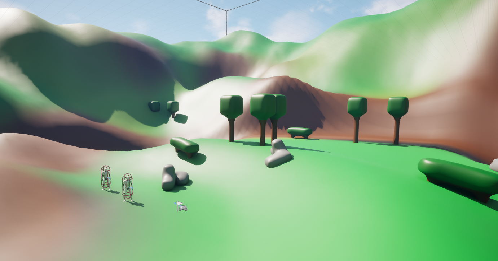
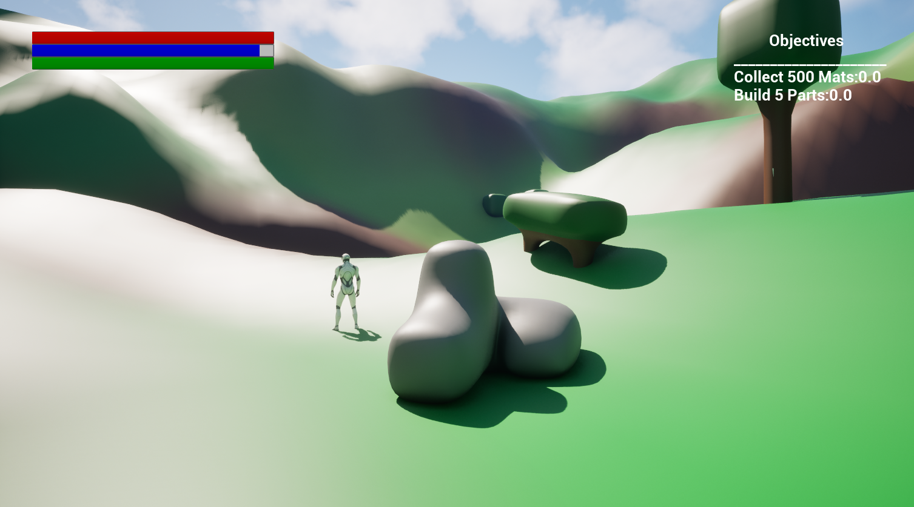
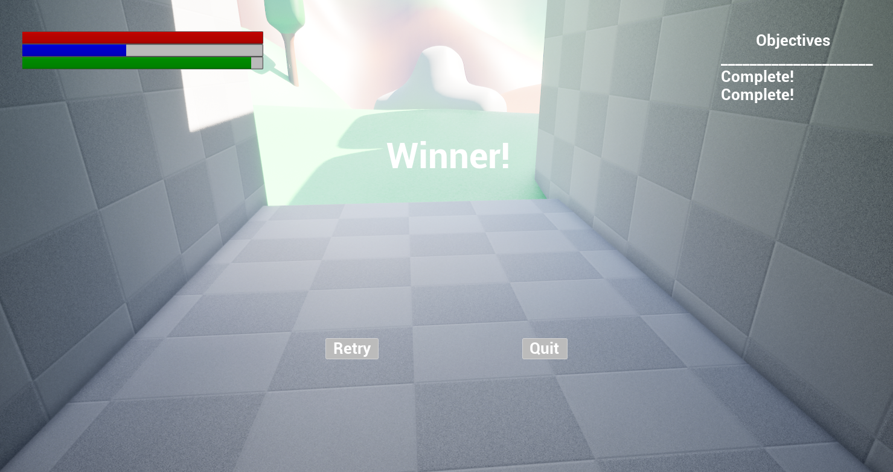

# Unreal Engine 5.7 — C++ Survival and Building Prototype

**Private portfolio preparation copy — not approved for publication**

An Unreal Engine coursework prototype exploring survival gameplay systems in C++, including resource gathering, health/hunger/stamina, building-piece placement, and on-screen objectives. This is a technical prototype, not a finished survival game.

## Implemented code systems

- **Player stats:** health, hunger, and stamina properties, plus timed hunger reduction and stamina recovery.
- **Resource gathering:** camera-based line tracing, resource actor depletion, inventory counters for wood, stone, and berries, and hit decals.
- **Building prototype:** resource-cost checks, build-part inventory, spawning a building actor in front of the camera, preview positioning, and rotation input.
- **Objectives and UI:** widget classes and updates for resource collection and building counts.
- **Resource actors:** static mesh and text label components.

## Representative C++ source

| Feature | Source |
| --- | --- |
| Player input, survival stats, gathering, building | [PlayerChar.cpp](Source/GAM312_Mills/PlayerChar.cpp) and [PlayerChar.h](Source/GAM312_Mills/PlayerChar.h) |
| Build-piece actor | [BuildingPart.cpp](Source/GAM312_Mills/BuildingPart.cpp) |
| Resource actor | [Resource_M.cpp](Source/GAM312_Mills/Resource_M.cpp) |
| Objective widget | [ObjectiveWidget.h](Source/GAM312_Mills/ObjectiveWidget.h) |
| Player HUD widget | [PlayerWidget.h](Source/GAM312_Mills/PlayerWidget.h) |

## Technology and setup

- Unreal Engine **5.7** (as specified in `GAM312_Mills.uproject`)
- C++, Unreal gameplay framework, UMG, Blueprint-integrated assets
- Open `GAM312_Mills.uproject` in Unreal Engine 5.7 with the Windows C++ development toolchain installed.
- Default map: `/Game/Maps/testMap`.

## Verified gameplay tests

The project owner opened and play-tested the **clean portfolio copy** in Unreal Engine **5.7** on November 7, 2026. All seven reported checks passed:

1. **PASS** — Project opens and C++ compiles in UE 5.7.
2. **PASS** — `testMap` loads and character movement works.
3. **PASS** — Health, hunger, and stamina HUD displays correctly.
4. **PASS** — Resource gathering works (wood, stone, or berries).
5. **PASS** — Gathered resources update in the player's inventory.
6. **PASS** — Building placement and rotation work.
7. **PASS** — Objectives update when collecting resources or building.

These are **user-reported in-editor functional tests**, not an automated test suite or independent code-quality audit. Source review has identified potential edge cases (including UI-pointer assumptions, repeated resource trace logic, and building-success reporting) that may merit future hardening; the passing tests do not establish that every edge case is resolved.

## Gameplay screenshots

Screenshots captured from the working Unreal Engine 5.7 prototype.

### Prototype environment

### Survival HUD and objectives

### Crafting and resource management

### Objective completion

**Gameplay video:** Not yet hosted in the repository. The screenshots and seven play-test results document the current portfolio demonstration.

## Provenance and publication

This project originates from SNHU GAM-312 coursework. Attribution and redistribution rights for Unreal template content and any other included binary assets must be checked before publication. Do not include packaged Windows builds, generated engine binaries, old Git history, or generated configuration tokens in the clean portfolio repository.

## Preparation checklist

- [x] Prepare a separate branch without modifying original `main`
- [x] Remove generated Android configuration token on preparation branch
- [x] Ignore packaged builds and generated files for the future clean import
- [x] Create a separate clean-history private portfolio repository
- [x] Compile and play-test the clean copy in Unreal Engine 5.7 (7/7 user-reported checks passed)
- [x] Add four actual gameplay screenshots
- [ ] Review asset rights and academic publication timing

**Keep private until explicitly approved.**
